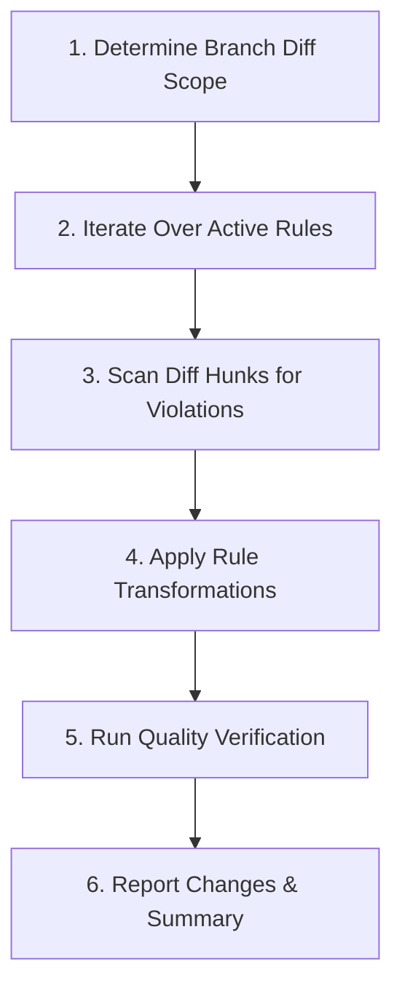

# Code Review Engine (`code-review`)

This skill inspects your codebase, identifies deviations from project architectural and coding standards, and applies standardized refactorings rule-by-rule.

> [!IMPORTANT]
> **Branch & Diff Scoping Principle**:
> Every rule in this skill is **strictly scoped to the specific branch being worked on and its diff against `main`/`master`** (including staged, unstaged, and untracked changes). Reviews and transformations must not touch unaffected legacy files across the repository unless explicitly commanded.

---

## 1. Active Rule Registry

| Rule ID | Name | Target Scope | Status | Specification |
| :--- | :--- | :--- | :--- | :--- |
| **RULE-001** | Theme UI Style Variables Extraction | Branch diff $\cap$ `apps/web/src/**/*.tsx` | **Active** | [RULE-001 Spec](./rules/001-theme-ui-style-variables.md) |
| **RULE-002** | Explicit Props Passing (Disallow Spreading) | Branch diff $\cap$ `apps/web/src/**/*.tsx` | **Active** | [RULE-002 Spec](./rules/002-explicit-props-passing.md) |
| **RULE-003** | Component Purity & Render Determinism | Branch diff $\cap$ `apps/web/src/**/*.tsx` | **Active** | [RULE-003 Spec](./rules/003-component-purity-and-determinism.md) |
| **RULE-004** | Behavioral & Cause-and-Effect Testing | Branch diff $\cap$ `apps/web/src/**/*.test.tsx` | **Active** | [RULE-004 Spec](./rules/004-behavioral-testing.md) |
| **RULE-005** | *Reserved for next rule* | Branch diff $\cap$ *TBD* | *Planned* | - |

---

## 2. Execution Workflow

When running this skill, execute the following cycle:



### Step 1: Determine Branch Diff Scope
Always scope the review to the files modified on the working branch relative to the primary base branch (`main` or `master`):

1. **Detect Primary Base Branch**:
   Check whether the repository uses `main` or `master`:
   ```bash
   BASE_BRANCH=$(git rev-parse --verify origin/main >/dev/null 2>&1 && echo "origin/main" || \
                 git rev-parse --verify main >/dev/null 2>&1 && echo "main" || \
                 git rev-parse --verify origin/master >/dev/null 2>&1 && echo "origin/master" || \
                 echo "master")
   ```

2. **Collect Changed Files in Branch Diff**:
   Find all files committed on the current branch since branching off `$BASE_BRANCH`, plus any uncommitted staged, unstaged, or untracked files:
   ```bash
   MERGE_BASE=$(git merge-base HEAD "$BASE_BRANCH" 2>/dev/null || echo "$BASE_BRANCH")
   
   # Committed branch diff + uncommitted changes:
   git diff --name-only "$MERGE_BASE"
   
   # Include untracked files:
   git status --porcelain
   ```

3. **Intersect with Rule File Patterns**:
   Filter the collected diff list against the rule's target file pattern (e.g., matching `apps/web/src/**/*.tsx` for `RULE-001`). Only files present in both the branch diff and the rule's target pattern are inspected.

### Step 2: Iterate Over Active Rules
Process each active rule in sequence from the [Active Rule Registry](#1-active-rule-registry):
1. Load the corresponding rule specification in `./rules/<rule-file>.md`.
2. Review the trigger conditions, transformation patterns, and exceptions.

### Step 3: Scan Diff Hunks for Violations
- For each file in the branch diff, inspect the added or modified lines (`git diff -U0 "$MERGE_BASE" -- <file>` or modified file contents).
- Identify deviations from the active rule within the newly introduced or edited code.
- Avoid introducing churn or large refactorings into unrelated, untouched sections of existing files unless necessary to satisfy the rule in the modified code.

### Step 4: Apply Rule Transformations
- Perform atomic edits using `edit_file` to refactor the code according to the rule pattern.
- Preserve all existing comments, docstrings, and unrelated logic.
- Ensure all newly extracted variables and helper functions are properly typed.

### Step 5: Execute Quality Verification
After applying the transformations, run the standard quality gates:

```bash
# 1. TypeScript type check
pnpm run typecheck

# 2. Biome linting & format validation
pnpm run biome:lint

# 3. Unit test suite
pnpm run test
```

### Step 6: Summary & Report
Provide a structured report listing:
- Branch name and base branch used for diff comparison.
- Files evaluated within the diff.
- Rules applied and specific transformations performed.
- Quality gate verification results.

---

## 3. How to Add New Rules

To add a new rule to this engine:

1. **Adhere to Branch Diff Scoping**:
   Ensure the rule targets only code within the branch's diff against `main`/`master`.

2. **Create Rule Specification**:
   Add a new markdown document under `./rules/<rule-id>-<short-name>.md` detailing:
   - Summary and motivation.
   - Target files (scoped to branch diff).
   - Trigger conditions and allowed exceptions.
   - "Before" and "After" code examples.
   - Transformation checklist.

3. **Register the Rule**:
   Add an entry to the [Active Rule Registry](#1-active-rule-registry) table above with its ID, name, branch-diff target scope, status (`Active`), and link to the specification.

4. **Verify the Rule**:
   Run the skill against the branch diff to ensure it refactors accurately and passes all quality checks.
