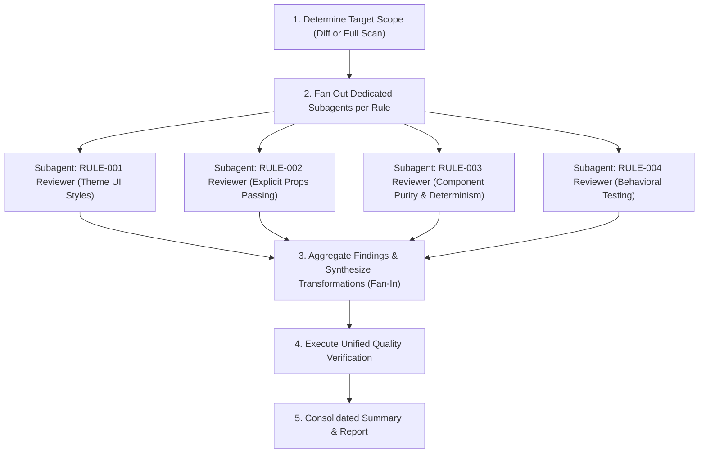

# Code Review Engine (`code-review`)

This skill inspects your codebase, identifies deviations from project architectural and coding standards, and applies standardized refactorings rule-by-rule by orchestrating concurrent subagents.

> [!IMPORTANT]
> **Branch & Diff Scoping Principle**:
> Every rule in this skill is **strictly scoped to the specific branch being worked on and its diff against `main`/`master`** (including staged, unstaged, and untracked changes). Reviews and transformations must not touch unaffected legacy files across the repository unless explicitly commanded (e.g. during an explicit full codebase scan).

---

## 1. Active Rule Registry

| Rule ID | Name | Target Scope | Status | Specification |
| :--- | :--- | :--- | :--- | :--- |
| **RULE-001** | Theme UI Style Variables Extraction | Branch diff $\cap$ `apps/web/src/**/*.tsx` | **Active** | [RULE-001 Spec](./rules/001-theme-ui-style-variables.md) |
| **RULE-002** | Explicit Props Passing (Disallow Spreading) | Branch diff $\cap$ `apps/web/src/**/*.tsx` | **Active** | [RULE-002 Spec](./rules/002-explicit-props-passing.md) |
| **RULE-003** | Component Purity & Render Determinism | Branch diff $\cap$ `apps/web/src/**/*.tsx` | **Active** | [RULE-003 Spec](./rules/003-component-purity-and-determinism.md) |
| **RULE-004** | Behavioral & Cause-and-Effect Testing | Branch diff $\cap$ `apps/web/src/**/*.test.tsx` | **Active** | [RULE-004 Spec](./rules/004-behavioral-testing.md) |
| **RULE-005** | *Reserved for next rule* | Branch diff $\cap$ *TBD* | *Planned* | - |

---

## 2. Multi-Agent Orchestration Workflow (Fan-Out / Fan-In)

When running this skill, the lead orchestrator coordinates inspection and refactoring by fanning out specialized subagents for each active rule in parallel:



### Step 1: Determine Review Scope
Scope the review to the files modified on the working branch relative to the primary base branch (`main` or `master`), unless an explicit full-codebase scan was commanded:

1. **Detect Primary Base Branch**:
   Check whether the repository uses `main` or `master`:
   ```bash
   BASE_BRANCH=$(git rev-parse --verify origin/main >/dev/null 2>&1 && echo "origin/main" || \
                 git rev-parse --verify main >/dev/null 2>&1 && echo "main" || \
                 git rev-parse --verify origin/master >/dev/null 2>&1 && echo "origin/master" || \
                 echo "master")
   ```

2. **Collect Target Files**:
   - **Branch Diff Mode (Default)**: Collect committed branch changes plus unstaged/untracked modifications:
     ```bash
     MERGE_BASE=$(git merge-base HEAD "$BASE_BRANCH" 2>/dev/null || echo "$BASE_BRANCH")
     git diff --name-only "$MERGE_BASE"
     git status --porcelain
     ```
   - **Full Scan Mode (Explicit Command Only)**: Find all matching files across `apps/web/src/`.

3. **Intersect with Rule File Patterns**:
   Filter the candidate files against each rule's target file pattern (e.g., matching `apps/web/src/**/*.tsx` for `RULE-001` or `*.test.tsx` for `RULE-004`).

### Step 2: Fan Out Dedicated Subagents per Rule (Parallel Fan-Out)
For each active rule in the registry with matching scoped files, the orchestrator invokes a specialized subagent using `invoke_subagent`:

1. **Subagent Configuration**:
   - **`TypeName`**: `"self"` (for refactoring with edit tools) or `"research"` (for read-only analysis).
   - **`Role`**: Descriptive role title specific to the rule, e.g.:
     - `RULE-001 Style Specialist`
     - `RULE-002 Props Reviewer`
     - `RULE-003 Purity Auditor`
     - `RULE-004 Test Auditor`
   - **`Prompt`**: Must contain:
     - The path to the specific rule specification in `./rules/<rule-file>.md`.
     - The exact list of target files or diff hunks to evaluate.
     - Instructions to scan for violations according to the trigger conditions and exceptions.
     - Directive to report precise line numbers, code snippets, and either apply the transformations directly or return concrete patch plans.

2. **Concurrent Execution**:
   - Dispatch all subagents in parallel.
   - Subagents run autonomously in the background; the orchestrator waits for completion notifications via reactive wakeups without polling.

### Step 3: Fan-In & Transformation Synthesis
- Aggregate the reported violations and refactoring results from all subagents.
- If multiple subagents touch the same file or overlapping hunks, reconcile the changes sequentially to prevent write conflicts.
- Ensure all extracted helpers, styles, or props strictly adhere to TypeScript typing and preserve existing docstrings and comments.

### Step 4: Execute Unified Quality Verification
Once all rule transformations are merged, run the repository quality gates:

```bash
# 1. TypeScript type check
pnpm run typecheck

# 2. Biome linting & format validation
pnpm run biome:lint

# 3. Unit test suite
pnpm run test
```

### Step 5: Consolidated Summary & Report
Provide a comprehensive report detailing:
- Scope mode (Branch diff against base branch, or full codebase scan).
- Subagents dispatched and their respective rule assignments.
- Rule-by-rule findings, violations detected, and files transformed (with clickable links).
- Verification results from the quality gates.

---

## 3. How to Add New Rules

To add a new rule to this engine:

1. **Adhere to Branch Diff Scoping**:
   Ensure the rule targets only code within the branch's diff against `main`/`master`.

2. **Create Rule Specification**:
   Add a new markdown document under `./rules/<rule-id>-<short-name>.md` detailing:
   - Summary and motivation.
   - Target files (scoped to branch diff).
   - Trigger conditions and allowed exceptions.
   - "Before" and "After" code examples.
   - Transformation checklist.

3. **Register the Rule**:
   Add an entry to the [Active Rule Registry](#1-active-rule-registry) table above with its ID, name, branch-diff target scope, status (`Active`), and link to the specification.

4. **Verify the Rule**:
   Run the skill against the branch diff to ensure it refactors accurately and passes all quality checks.
