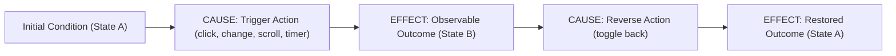

# RULE-004: Behavioral & Cause-and-Effect Testing

## Summary
To ensure tests provide genuine confidence in software reliability, all unit tests in `apps/web` must verify component **behavior and state transitions (Cause $\rightarrow$ Effect)** rather than merely asserting that static text or DOM nodes are displayed.

---

## Scope & Applicability
- **Target Files**: Test files added or modified in the current working branch diff against `main`/`master` matching `apps/web/src/**/*.test.tsx` (and `*.test.ts`, `*.spec.tsx`).
- **Diff Constraint**: Do not rewrite existing legacy tests outside the branch diff. Enforce this rule on tests introduced or updated within the branch diff.
- **Trigger Conditions**:
  - Test cases that only assert static text existence (`expect(screen.getByText(...)).toBeInTheDocument()`) without simulating any user interaction, state change, or accessibility contract verification.
  - Snapshot tests that solely capture static markup without exercising dynamic states.
  - Tests asserting internal component implementation details (e.g. inspecting private component state or styling classes) instead of observable user outcomes.

---

## Core Principles

### 1. Cause and Effect (Action $\rightarrow$ Outcome)
Every interactive test must model a clear **Cause** (user action, system event, timer advancement) and assert on the observable **Effect** (UI update, accessibility attribute change, callback invocation, navigation):



---

### 2. Disallow Superficial Existence Testing as Sole Verification
Asserting that static text appears in the DOM provides little value if the test never validates that the component actually functions.

#### Anti-pattern (Display-Only Test)
```tsx
// ❌ Bad: Merely asserts that text is mounted. Tests zero behavior or functionality.
it("renders the collapsible section", () => {
  render(
    <Collapsible title="Setup Guide">
      <p>Body copy</p>
    </Collapsible>,
  );

  expect(screen.getByText("Setup Guide")).toBeInTheDocument();
  expect(screen.getByText("Body copy")).toBeInTheDocument();
});
```

#### Compliant Pattern (Cause-and-Effect Behavioral Test)
```tsx
// ✅ Good: Verifies initial state, action, and resulting state transition
it("expands content on click and updates accessibility attributes", () => {
  render(
    <Collapsible title="Setup Guide">
      <p>Hidden body text</p>
    </Collapsible>,
  );

  const button = screen.getByRole("button", { name: /Setup Guide/i });
  const content = screen.getByText("Hidden body text").closest("section");

  // Initial State: Section is collapsed and content is hidden
  expect(button).toHaveAttribute("aria-expanded", "false");
  expect(content).toHaveAttribute("hidden");

  // CAUSE: User clicks the button to expand
  fireEvent.click(button);

  // EFFECT: State changes to expanded, content is revealed
  expect(button).toHaveAttribute("aria-expanded", "true");
  expect(content).not.toHaveAttribute("hidden");

  // CAUSE: User clicks again to collapse (round-trip verification)
  fireEvent.click(button);

  // EFFECT: Restored to collapsed state
  expect(button).toHaveAttribute("aria-expanded", "false");
  expect(content).toHaveAttribute("hidden");
});
```

---

### 3. Query Through the Accessibility Tree
Always query elements the way assistive technologies and users find them: by role, label, and accessible name (`getByRole`, `getByLabelText`, `getByPlaceholderText`) rather than generic class selectors or arbitrary test IDs:

#### Anti-pattern (Implementation Detail Queries)
```tsx
// ❌ Bad: Relies on CSS class selectors that break during styling refactors
const btn = container.querySelector(".collapsible-toggle-btn");
expect(btn.classList.contains("active")).toBe(true);
```

#### Compliant Pattern (Semantic Accessible Role Queries)
```tsx
// ✅ Good: Queries accessible role and verifies aria-expanded attribute
const button = screen.getByRole("button", { name: /Setup Guide/i });
expect(button).toHaveAttribute("aria-expanded", "true");
```

---

### 4. Complete Round-Trip State Transitions
When testing interactive components with toggleable, modal, or expandable states, always test the **complete round-trip**:
1. Check initial state (e.g. collapsed / closed).
2. Trigger the opening action and assert opened state.
3. Trigger the closing action and assert return to initial state.

---

### 5. Deterministic Timer & Scroll Testing
When component behavior involves asynchronous timeouts, debounce intervals, or scroll listeners, use fake timers and explicit scroll dispatching to test deterministic cause and effect:

```tsx
it("preserves highlight on navigation scroll and clears when user scrolls away", () => {
  render(<CitationDemo />);

  const citation = screen.getByText("(Reference 1)");
  
  // CAUSE 1: Click citation
  fireEvent.click(citation);
  
  // EFFECT 1: Target reference is highlighted
  const refItem = screen.getByText("Ref content").closest("li");
  expect(refItem).toHaveAttribute("data-highlighted", "true");

  // CAUSE 2: Scroll settle debounce timer completes
  act(() => {
    jest.advanceTimersByTime(350);
  });
  expect(refItem).toHaveAttribute("data-highlighted", "true");

  // CAUSE 3: User scrolls away past tolerance threshold
  Object.defineProperty(window, "scrollY", { value: 150, writable: true });
  fireEvent.scroll(window);

  // EFFECT 3: Highlight is dismissed
  expect(refItem).not.toHaveAttribute("data-highlighted");
});
```

---

## Allowed Exceptions
- **Pure Snapshot / Visual Regression Suites**: Dedicated visual regression test files (e.g. Storybook interaction tests or Playwright visual diffs) where visual screenshot capture is the designated assertion.
- **Static Contract Smoke Tests**: Basic mounting smoke tests, provided they are part of a test suite that contains full behavioral tests for all interactive paths.

---

## Transformation Checklist
1. [ ] Review each test in the diff: does it establish an initial condition, execute a cause (interaction/event), and assert on the effect?
2. [ ] Replace bare `toBeInTheDocument()` assertions with semantic accessibility state checks (`aria-expanded`, `aria-hidden`, `disabled`, `data-highlighted`).
3. [ ] Verify that toggleable/expandable components test both opening and closing transitions.
4. [ ] Ensure element queries use `getByRole`, `getByLabelText`, or accessible queries instead of CSS selectors.
5. [ ] Run `pnpm run test` to ensure all tests pass cleanly.
