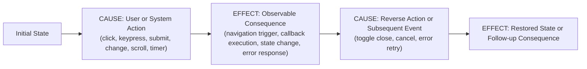

# RULE-004: Strict Behavioral Cause-and-Effect Testing

## Summary
Unit tests in `apps/web` must **never test if something is rendered or displayed**. Asserting that static text, headings, images, landmarks, or DOM elements are mounted (`toBeInTheDocument()`, `toBeVisible()`) provides zero verification of software functionality.

Instead, all unit tests must strictly verify **behavior: Cause $\rightarrow$ Effect**. Every test must simulate a concrete stimulus or action (Cause) and assert on the verifiable consequence (Effect).

---

## Scope & Applicability
- **Target Files**: Test files added or modified in the current working branch diff against `main`/`master` matching `apps/web/src/**/*.test.tsx` (and `*.test.ts`, `*.spec.tsx`).
- **Diff Constraint**: Do not rewrite existing legacy tests outside the branch diff. Enforce this rule strictly on tests introduced or updated within the branch diff.
- **Trigger Conditions (Disallowed Patterns)**:
  - Asserting that static props, titles, descriptions, dates, or body text are rendered (`expect(screen.getByText(...)).toBeInTheDocument()`).
  - Asserting that images, icons, containers, cards, or landmarks exist in the DOM without testing an interaction contract.
  - Snapshot tests that capture static markup.
  - Presence checks disguised as accessibility tests (e.g., merely checking `screen.getByRole("heading")` or `screen.getByRole("article")` without an interaction).

---

## Core Principles: Behavior = Cause $\rightarrow$ Effect



### 1. What Constitutes a "Cause"
A test must trigger a clear, realistic action:
- **User Input Actions**: `fireEvent.click`, `fireEvent.change`, `fireEvent.keyDown`, `fireEvent.submit`, `fireEvent.focus`, `fireEvent.blur`.
- **System Events**: Fake timer advancement (`jest.advanceTimersByTime`), scroll events (`fireEvent.scroll`), window resize.
- **Asynchronous Resolutions**: Network mock resolution (successful API response, network error, timeout).

### 2. What Constitutes an "Effect"
The assertion must verify an observable functional outcome:
- **Navigation Invocation**: Clicking an actionable item (button, link, card) triggers navigation to the expected destination URL or dispatches the navigation event.
- **Callback Invocation**: External props callbacks (`onClick`, `onSelect`, `onSubmit`, `onChange`) are invoked with exact expected arguments.
- **Dynamic State Transitions**: A component changes its operational state (e.g. expands/collapses, opens/closes modal, enables/disables buttons, switches active tab).
- **Validation & Error Handling**: Invalid user input causes validation errors to appear; successful recovery clears errors.
- **Async Workflow Outcomes**: In-flight requests disable submit triggers; completed responses reveal confirmation screens.

---

## Standard Patterns by Component Category

### 1. Navigational Items & Cards (e.g., `PostCard`, `ProjectCard`, `LinkCard`)
Cards and listings are interactive gateways. Do **not** test that the card displays its title, date, excerpt, or image. Test the **navigation behavior**:

#### ❌ Anti-pattern (Display / Render Testing)
```tsx
// ❌ WRONG: Tests if text and images are rendered. Zero behavior verified!
it("renders post card with title and date", () => {
  render(<PostCard post={mockPost} />);

  expect(screen.getByText("My Post")).toBeInTheDocument();
  expect(screen.getByText("November 2026")).toBeInTheDocument();
  expect(screen.getByRole("img")).toBeInTheDocument();
});
```

#### ✅ Compliant Pattern (Behavioral Cause $\rightarrow$ Effect)
```tsx
// ✅ RIGHT: Tests cause (click/keypress) and effect (navigation dispatch)
it("triggers navigation to post slug when user clicks the read action", () => {
  render(<PostCard post={mockPost} />);

  const link = screen.getByRole("link", { name: "read_post" });
  const button = screen.getByRole("button", { name: /read/i });

  const handleNavigate = jest.fn((e) => e.preventDefault());
  link.addEventListener("click", handleNavigate);

  // CAUSE: User clicks the action button
  fireEvent.click(button);

  // EFFECT: Navigation is triggered for the specific post slug
  expect(handleNavigate).toHaveBeenCalledTimes(1);
  expect(link).toHaveAttribute("href", "/blog/my-post");
});

it("triggers navigation when activated via keyboard Enter", () => {
  render(<PostCard post={mockPost} />);

  const link = screen.getByRole("link", { name: "read_post" });
  const handleNavigate = jest.fn((e) => e.preventDefault());
  link.addEventListener("click", handleNavigate);

  // CAUSE: User presses Enter on the link
  fireEvent.keyDown(link, { key: "Enter", code: "Enter" });
  fireEvent.click(link);

  // EFFECT: Navigation executed
  expect(handleNavigate).toHaveBeenCalledTimes(1);
});
```

---

### 2. Interactive Toggleable / Expandable Components (e.g., `Collapsible`, `Dialog`, `SideNav`)
Always test the **complete round-trip state transition**:

```tsx
it("toggles expanded state across complete open and close round-trip", () => {
  render(
    <Collapsible title="Preferences">
      <p>Hidden settings</p>
    </Collapsible>,
  );

  const button = screen.getByRole("button", { name: /Preferences/i });
  const content = screen.getByText("Hidden settings").closest("section");

  // Initial State: Hidden
  expect(button).toHaveAttribute("aria-expanded", "false");
  expect(content).toHaveAttribute("hidden");

  // CAUSE 1: User clicks to expand
  fireEvent.click(button);

  // EFFECT 1: State transitions to expanded
  expect(button).toHaveAttribute("aria-expanded", "true");
  expect(content).not.toHaveAttribute("hidden");

  // CAUSE 2: User clicks again to collapse
  fireEvent.click(button);

  // EFFECT 2: State restored to collapsed
  expect(button).toHaveAttribute("aria-expanded", "false");
  expect(content).toHaveAttribute("hidden");
});
```

---

### 3. Forms & Mutation Workflows (e.g., `ContactForm`)
Test user input, validation triggers, in-flight submission state, and terminal outcomes:

```tsx
it("locks submit button during in-flight network request and displays error on failure", async () => {
  (global.fetch as jest.Mock).mockReturnValueOnce(
    Promise.resolve({ ok: false, status: 500 }),
  );

  render(<ContactForm />);

  // CAUSE 1: User fills fields and submits
  fireEvent.change(screen.getByPlaceholderText("Email"), { target: { value: "user@test.com" } });
  fireEvent.click(screen.getByRole("button", { name: /send/i }));

  // EFFECT 1: Button is disabled while request is active
  await waitFor(() => {
    expect(screen.getByRole("button", { name: /sending/i })).toBeDisabled();
  });

  // EFFECT 2: Error alert displayed upon failure and button re-enabled
  await waitFor(() => {
    expect(screen.getByRole("alert")).toBeInTheDocument();
    expect(screen.getByRole("button", { name: /send/i })).not.toBeDisabled();
  });
});
```

---

## Transformation & Audit Checklist
Before approving any test suite:
1. [ ] **No Display Checks**: Did you eliminate all tests that merely check if titles, dates, excerpts, images, or DOM nodes are displayed (`toBeInTheDocument()`)?
2. [ ] **Explicit Cause**: Does every test case trigger a clear action (user event, keyboard event, timer tick, or async response)?
3. [ ] **Observable Effect**: Does the assertion verify an outcome of that cause (navigation, callback execution, state toggle, or error handling)?
4. [ ] **Round-Trip Transitions**: For stateful components, are both opening and closing / activating and deactivating paths verified?
5. [ ] **Green Quality Gates**: Do all tests pass via `pnpm test`?
