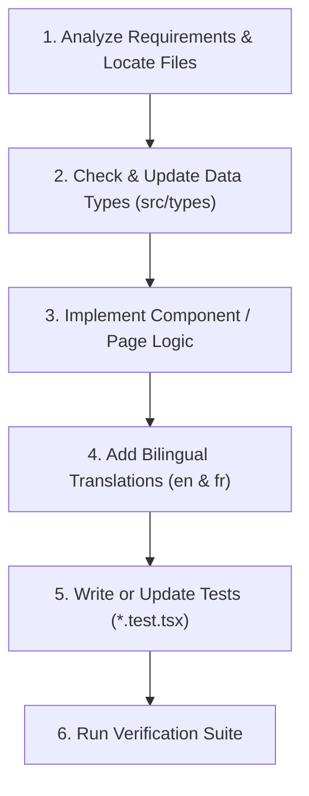

# PersonalSite Context & Feature Workflow

This skill equips the agent with complete context for developing features, fixing bugs, and maintaining the PersonalSite repository.

---

## 1. Monorepo Overview

The repository is managed using `pnpm` workspaces:

- **`apps/web`**: Gatsby 5 portfolio site powered by React 18, TypeScript, Theme UI, and MDX content.
- **`packages/contracts`**: Smart contracts workspace built with Hardhat, Solidity 0.8+, and OpenZeppelin.
- **Root tooling**: Biome for unified linting and formatting, Husky + lint-staged for git hooks.

For a detailed architectural breakdown, see [Architecture Deep Dive](./references/architecture.md).

---

## 2. Core Development Rules

### Rule 1: Strict Bilingual Support (i18n)
All user-visible text **must** be localized in both English (`en`) and French (`fr`):
- Translation files live in `apps/web/locales/{en,fr}/<namespace>.json`.
- Use `useTranslation("<namespace>")` from `gatsby-plugin-react-i18next`.
- Internal navigation must use `Link` from `gatsby-plugin-react-i18next` (to maintain the active `/fr/` locale prefix).
- Shared UI copy belongs in `common.json`; page-specific copy belongs in the page namespace (e.g. `about.json`, `projects.json`).
- See [Internationalization Guide](./references/i18n.md) for full instructions.

### Rule 2: TypeScript & Theme UI
- All web code is written in TypeScript (`.ts` / `.tsx`).
- Type check with `pnpm run typecheck` (`tsc --noEmit`).
- Use `ThemeUIStyleObject` from `theme-ui` for responsive `sx` style objects.
- Shared data types reside in `apps/web/src/types/index.ts`.
- See [Data Models & Content Pipeline](./references/data-models.md).

### Rule 3: Git File Operations
- Always preserve file history when renaming or moving files using `git mv`.
- Keep changes scoped to their relevant workspace package without polluting others.

---

## 3. Feature Development Lifecycle

When implementing any feature or change, follow this sequence:



### Step 1: Locate Files & Scope
- **Pages**: `apps/web/src/pages/`
- **Dynamic Templates**: `apps/web/src/templates/` (and query configs in `gatsby-node.ts`)
- **Components**: `apps/web/src/components/`
- **Theme & Styles**: `apps/web/src/theme/` and `apps/web/src/css/`
- **Smart Contracts**: `packages/contracts/contracts/`

### Step 2: Implement Logic & Typing
- Ensure props and GraphQL query outputs are typed.
- Maintain accessibility attributes (`aria-label`, image `alt` texts).

### Step 3: Localize All Text
- Add keys to `apps/web/locales/en/<namespace>.json`.
- Add equivalent French translations to `apps/web/locales/fr/<namespace>.json`.

### Step 4: Add / Update Tests
- Write unit tests alongside components in `*.test.tsx` using `@testing-library/react`.
- When testing localized components, remember `useTranslation` or mock the i18n hook if appropriate.

### Step 5: Execute Quality Gates
Run the verification commands before completing any task:

```bash
# 1. Type check
pnpm run typecheck

# 2. Unit tests
pnpm run test

# 3. Linter & formatting
pnpm run biome:lint

# 4. Production build
pnpm run build
```

If smart contracts are altered:
```bash
pnpm run test:contracts
```

For debugging tips and troubleshooting, refer to [Verification Runbook](./references/verification.md).
